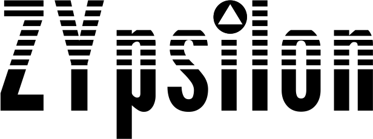

# ZYpsilon · Laboratorio di proiezioni

**Un laboratorio 3D interattivo e gratuito per la geometria descrittiva.** Mostra come si costruiscono proiezioni ortogonali (Monge), assonometrie, prospettiva, ombre e sezioni: un piano di proiezione, un solido, i raggi proiettanti e l'immagine che si forma sul piano — tutto nel browser, senza installare nulla. Novità della 1.2: il **Laboratorio di compenetrazione**, dove due solidi e un piano secante si incontrano. Novità della 1.2.2: il **foglio da disegno** (A4 · A3 · A2, in centimetri) con *Impagina* ed esportazione in **PDF**.

**Online:** [www.zypsilon.com](https://www.zypsilon.com) · **Come citarlo:** [10.5281/zenodo.24405119](https://doi.org/10.5281/zenodo.24405119) · **Licenza:** [PolyForm Noncommercial 1.0.0](LICENSE) · 🇬🇧 [English](README.md) · 🇨🇳 [中文](README.zh.md)

Interfaccia in **inglese, italiano e cinese semplificato** (selettore in alto a destra nel pannello). L'applicazione si apre nella lingua del browser: italiano, cinese o, per ogni altra lingua, inglese (la lingua scelta con il selettore viene ricordata; `?lang=it`, `?lang=en` o `?lang=zh` la impongono). I punti si chiamano con le lettere latine maiuscole A, B, C … in tutte le lingue (proiezioni: A′ A″ A‴ in italiano, a a′ a″ in inglese e cinese); in cinese i piani sono 正立面, 水平面, 侧立面. Il testo di riferimento del progetto è l'[inglese](README.md); questa pagina ne è la traduzione.

## Cosa mostra

- **Proiezioni ortogonali (Monge)**: tre piani di proiezione (verticale PV, orizzontale PO, laterale PL) con il solido nel primo diedro. Il cursore *Ribaltamento dei piani* ruota PO e PL attorno alle intersezioni con PV fino a ottenere il foglio da disegno: prospetto, pianta e vista laterale con linea di terra e linee di richiamo. Le lettere dei vertici (A, A″, A′, A‴ …), le proiezioni coincidenti (≡) e le tracce sono indicate; la notazione segue la lingua scelta.
- **Assonometria ortogonale**: isometrica; in modalità avanzata anche dimetrica e trimetrica.
- **Assonometria obliqua**: cavaliera, cabinet (cavaliera ridotta), monometrica (piano verticale); planometrica, planometrica ridotta e militare (piano orizzontale).
- **Prospettiva**: frontale (un punto di fuga), accidentale (due) e a tre punti di fuga, con linea d'orizzonte, linea di terra, punto principale e punti di fuga.
- **Solidi**: cubo, parallelepipedo e piramide a base quadrata; prismi e piramidi a base triangolare, pentagonale, esagonale e ottagonale; cilindro, cono e sfera (con il contorno apparente); e il **logo ZYpsilon in 3D**. Lettere sui vertici dei poliedri; sui solidi curvi, sui punti che li definiscono.
- **Misure**: un interruttore accanto a *Solido* permette di scrivere le dimensioni (lato, lunghezza/larghezza/altezza, diametro/altezza) in **centimetri**, con limiti tarati su un foglio A3 in scala 1:1 — da 2 a 15 cm nelle proiezioni ortogonali, da 3 a 14 cm in assonometria, da 5 a 30 cm in prospettiva (il riferimento è il prisma esagonale, il solido più ingombrante tra quelli comuni). Il logo non si dimensiona, si può solo scalare.
- **Piano secante (sezioni)**: taglia davvero il solido. La parte asportata resta appena visibile, la sezione è colorata, e immagine, linee nascoste, proiezioni di Monge e lettere seguono il taglio. In Monge il piano secante è per default ortogonale a un piano di proiezione e si ribalta insieme agli altri, dando la vera forma della sezione con la classica costruzione ad arco; l'opzione *piano generico* lo libera in ogni direzione. Cursori **e valori digitati** sono disponibili.
- **Ombre**: raggi paralleli (sole, due angoli) o sorgente puntiforme (lampada, tre coordinate); ombra propria, ombra portata sui piani di riferimento, raggi luminosi e costruzione guidata dell'ombra, un vertice alla volta. In prospettiva la costruzione usa i punti di fuga dei raggi luminosi (FL e FL′) e la **retta di fuga dei raggi luminosi** tratteggiata che passa per essi; si disegnano solo i raggi dei vertici che delimitano davvero l'ombra, così la costruzione resta leggibile.
- **Laboratorio di compenetrazione** (*novità della 1.2*): una modalità didattica, che si attiva dall'interruttore sotto il logo, per il problema classico della **compenetrazione di due solidi con il metodo dei piani secanti**. Scegli il solido **A** e il solido **B** tra le forme consuete (prismi, piramidi, cilindro, cono, sfera …) e assegna a ciascuno l'asse (verticale o orizzontale), la rotazione attorno ad esso e la posizione — con cursori **o valori digitati**; *Centra i due solidi* fa coincidere i loro centri nel centro dei piani di proiezione (il centro di un solido è il punto a metà altezza sull'asse che passa per il centro della base); il lab parte con la coppia classica, un prisma a base quadrata con asse orizzontale e un prisma esagonale verticale. Poi fai scorrere un piano secante parallelo al piano orizzontale, frontale o di profilo (o animalo): taglia entrambi i solidi e i pallini rossi segnano dove il contorno della sezione di A incontra quello della sezione di B — punti della **curva di compenetrazione**. La curva si costruisce punto per punto (con una scia opzionale dei nodi) e compare in proiezioni ortogonali e in assonometria, con i punti contrassegnati da lettere. *Colore* tinge diversamente i due solidi e le sezioni. Il foglio da disegno (vedi sotto) funziona anche nel laboratorio, e i punti della curva che cadono su una faccia di un solido sono uniti alla loro generatrice. La prospettiva non fa parte del laboratorio; disattivandolo si ritrova la scena di prima.
- **Strumenti per la prospettiva**: seleziona uno spigolo per vederne la traccia sul quadro, il punto di fuga, la costruzione del piano ribaltato e il punto di misura.
- **Modalità avanzata**: orientamento (ψ, φ, θ attorno a Z, X, Y), solido o quadro come elemento che si inclina, scala, distanze, direzione dei raggi (α, q), punto di vista, più le assonometrie aggiuntive non ottenibili con le squadre. Disattivata, restano solo le proiezioni eseguibili con le squadre e le tre prospettive, come nei manuali di disegno.
- **Foglio da disegno** (*novità della 1.2.2*): il pulsante *Foglio* sceglie A4, A3 o A2, orizzontale o verticale. Tutte le misure sono in centimetri e il disegno è in scala 1:1: quello che vedi è quello che disegneresti. Lo *spazio foglio* mostra la tavola con squadratura, assi e sigle dei piani (in prospettiva anche linea di terra, orizzonte, punto principale, punto di stazione ribaltato e punti di fuga); nella vista 3D i piani di proiezione ribaltati conservano il loro colore. **Impagina** mette il disegno al centro della squadratura: in prospettiva centra tutta la costruzione — figura, linea di terra, orizzonte, punto di stazione ribaltato, punti di fuga — senza spostare il solido; nelle altre modalità posiziona il solido in modo che ogni vista stia al centro del suo quadrante (proiezioni ortogonali) o l'immagine al centro della squadratura. Il disegno **non viene mai ridotto o ingrandito in automatico**: compare un breve avviso solo quando qualcosa non entra (viste troppo grandi: di quanto ridurre le misure, o un foglio più grande; costruzione fuori dalla squadratura; disegno non centrato → *Impagina*) e scompare appena tutto è dentro. Le linee seguono le convenzioni del disegno: costruzione sottile, chiara e continua; contorni di proiezione più marcati; spigoli nascosti tratteggiati scuri; il marchio ZYpsilon e il sito stanno dentro la squadratura, in basso a destra.
- **Viste rapide e output**: 3D, pianta, prospetto laterale, «lungo i raggi»; tre disposizioni (3D a tutto schermo con piccola immagine, vista divisa, immagine grande); una barra fissa al centro in basso con le disposizioni, **Scarica** (immagine PNG oppure **PDF**, con pagina nel formato di foglio scelto — A3 orizzontale se non ce n'è — e un link cliccabile che riapre proprio quel disegno) e **Link**, che copia un indirizzo web che riapre la stessa scena (le impostazioni stanno dopo il `#`, che il browser non invia mai a un server); **Salva / Apri** una scena come file `.json` (le scene conservano il foglio scelto).

## Come si usa

Apri <https://www.zypsilon.com>, oppure scarica il repository e fai doppio clic su `index.html` — non serve un server e funziona anche offline: three.js è incluso in `vendor/`. `proiezioni-standalone.html` è la stessa applicazione in un solo file, comodo da copiare o inviare.

Comandi: trascina per ruotare, Maiusc + trascinamento (o clic destro) per spostare, rotella o pinch per l'ingrandimento. Funziona anche su schermi touch e LIM: un dito ruota, due dita spostano e ingrandiscono.

## Modello geometrico

Il quadro è il piano verticale `y = 0`, l'osservatore sta in `y < 0` e il solido dietro il quadro (`y > 0`). Assi: X verso destra, Y in profondità, Z in alto. Il solido è orientato da `R = Rx(φ) · Rz(ψ)`.

- Proiezione parallela ortogonale: raggi lungo `+Y`.
- Proiezione parallela obliqua: raggi lungo `(-q·cos α, 1, -q·sin α)`.
- Prospettiva: raggi dal punto `O = (Ex, -D, Ez)`; il punto di fuga di una direzione `a` è `O + a·D/a_y`, se `a_y ≠ 0`.

Le unità sono numeri puri: 1 è il lato del cubo iniziale.

## Licenza, uso commerciale e citazione

> Il testo giuridico di riferimento è quello in [inglese](README.md#licence-commercial-use-and-citation) e nel file [LICENSE](LICENSE); qui sotto ne trovi una sintesi in italiano.

**Gratuito per studio, didattica e ricerca.** ZYpsilon è distribuito con licenza [PolyForm Noncommercial 1.0.0](LICENSE). Uso, copia e modifica per scopi non commerciali — inclusi studenti, docenti, scuole, università ed enti pubblici di ricerca — sono liberi. Va ridistribuito gratuitamente, lasciando invariati la licenza, il file [NOTICE](NOTICE), i crediti e il link a [www.zypsilon.com](https://www.zypsilon.com).

**L'uso commerciale richiede una licenza scritta a parte.** Ogni uso da parte o per conto di un soggetto a fini di lucro — case editrici comprese — richiede una licenza dell'autore: per esempio includere o incorporare il software, le sue schermate, grafiche o il logo in libri, libri di testo digitali, app, corsi o siti venduti o con pubblicità, oppure ospitarlo su una piattaforma commerciale. Citare o nominare ZYpsilon (per esempio in una bibliografia) e linkare www.zypsilon.com è libero per tutti. Nome e logo ZYpsilon non possono essere usati per suggerire approvazione, collaborazione o affiliazione senza permesso scritto.

- *Libero, senza chiedere:* studenti, docenti e scuole; università ed enti pubblici di ricerca (didattica e ricerca non commerciali); enti benefici e pubbliche amministrazioni; chiunque lo citi o lo linki.
- *Serve una licenza:* editori (libri, libri di testo digitali, siti o app collegati); aziende ed enti di formazione (corsi a pagamento, e-learning commerciale); chi incorpora, include o ospita ZYpsilon in software o siti; uso professionale o aziendale in attività retribuite; ogni altro uso commerciale.
- *Chi contattare:* non c'è un listino; le licenze si concordano caso per caso. Scrivi a [info@zypsilon.com](mailto:info@zypsilon.com?subject=ZYpsilon%20licence%20request) dicendo chi sei, cosa intendi fare, per quale pubblico, per quanto tempo e in quali paesi. Le stesse informazioni sono nella pagina «Licenze, uso e privacy» dell'applicazione.

**Come citarlo.** ZYpsilon è archiviato su Zenodo: DOI [10.5281/zenodo.24405119](https://doi.org/10.5281/zenodo.24405119), che rimanda sempre all'ultima versione (ogni release ha anche un proprio DOI di versione). Vedi anche [`CITATION.cff`](CITATION.cff): GitHub mostra il pulsante «Cite this repository». Le scene salvate come link (pulsante **Link**) aprono il sito ufficiale e si possono condividere liberamente; incorporare l'applicazione in altre pagine o copiarla su altri siti rientra nei termini di licenza.

## Privacy

L'applicazione non raccoglie dati personali: nessun account, modulo o contenuto inviato a un server. Memorizza nel browser soltanto la lingua scelta, la scelta sul consenso e, se lo chiedi, di non rivedere il promemoria della donazione. Scene salvate, immagini PNG e PDF si producono sul tuo dispositivo; il link dentro il PDF contiene solo le impostazioni della scena (dopo il `#`). Servizi di terze parti: Google Fonts (caratteri) e, sul sito online, cdnjs (three.js; se non è raggiungibile si usa la copia in `vendor/`).

**Google Analytics** viene caricato solo sul sito ufficiale (www.zypsilon.com) e solo dopo il consenso; alla prima visita, e di nuovo dopo sei mesi, compare un banner con i pulsanti *Rifiuta* e *Accetta* ugualmente evidenti; dopo *Rifiuta* l'applicazione continua a funzionare e un breve avviso conferma che le statistiche sono disattivate, con un link per cambiare scelta. Le copie scaricate, i file locali e gli altri host non caricano né inviano nulla e non mostrano il banner. Due link in fondo al pannello aprono le pagine a tutto schermo *Licenze, uso e privacy* e *Cookie e consenso* (in italiano, inglese e cinese). Fai verificare i testi legali da un professionista prima di farci affidamento nel tuo ordinamento.

## Sostegno

Il pulsante *Sostieni il progetto* porta a <https://ko-fi.com/openapp>. `.github/FUNDING.yml` attiva il pulsante *Sponsor* su GitHub.

## Crediti

Grafica 3D con [three.js](https://threejs.org/) r128 (licenza MIT), inclusa in `vendor/three.min.js`. I caratteri IBM Plex e Newsreader sono caricati da Google Fonts quando si è online; offline si usano i caratteri di sistema.

Sviluppato da Baires Raffaelli con il nome ZYpsilon — [www.zypsilon.com](https://www.zypsilon.com) · [info@zypsilon.com](mailto:info@zypsilon.com).
