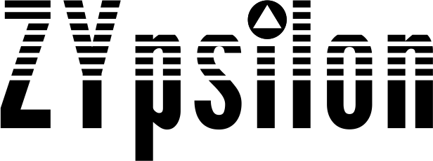

# ZYpsilon · Projection lab

**A free, interactive 3D laboratory for descriptive geometry.** See how orthogonal projections (Monge), axonometry, perspective, shadows and sections are built: a projection plane, a solid, the projecting rays and the image that forms on the plane — all in your browser, nothing to install. New in 1.2: the **Intersection Lab**, where two solids and a cutting plane meet.

**Live:** [www.zypsilon.com](https://www.zypsilon.com) · **Cite:** [10.5281/zenodo.24405119](https://doi.org/10.5281/zenodo.24405119) · **Licence:** [PolyForm Noncommercial 1.0.0](LICENSE) · 🇮🇹 [Italiano](README.it.md) · 🇨🇳 [中文](README.zh.md)

Interface in **English, Italian and Simplified Chinese** (selector at the top right of the panel; the browser language is used on first visit, or force it with `?lang=en`, `?lang=it`, `?lang=zh`).

## What it shows

- **Orthogonal projections (Monge)**: three projection planes (vertical VP, horizontal HP, lateral LP) with the solid in the first dihedral. The *Folding of the planes* slider rotates HP and LP around their intersections with VP until the drawing sheet appears: front view, plan and side view with ground line and projector lines. Vertex letters (A, A″, A′, A‴ …), coincident projections (≡) and traces are labelled; notation follows the chosen language.
- **Orthogonal axonometry**: isometric; with the advanced mode also dimetric and trimetric.
- **Oblique axonometry**: cavalier, cabinet (reduced cavalier), monometric (vertical plane); planometric, reduced planometric and military (horizontal plane).
- **Perspective**: frontal (one vanishing point), accidental (two) and three-point, with horizon line, ground line, principal point and vanishing points.
- **Solids**: cube, cuboid and square pyramid; prisms and pyramids on triangular, pentagonal, hexagonal and octagonal bases; cylinder, cone and sphere (the apparent contour is drawn); and the **ZYpsilon logo in 3D**. Vertex letters on polyhedra; on curved solids on their defining points.
- **Measures**: a switch next to *Solid* lets you type the size of the solid (side, length/width/height, diameter/height), from 2 to 15 in a unit of your choice — 1 can be a centimetre or a metre. The logo cannot be resized by measures, only scaled.
- **Cutting plane (sections)**: cuts the solid for real. The removed part stays faintly visible, the section is coloured, and image, hidden edges, Monge projections and vertex letters follow the cut. In Monge the cutting plane is orthogonal to a projection plane by default and folds down together with the other planes, giving the true shape of the section with the classic arc construction; a *generic plane* option frees it in every direction. Sliders **and typed values** are available.
- **Shadows**: parallel rays (sun, two angles) or a point source (lamp, three coordinates); own shadow, cast shadow on the reference planes, light rays and the guided construction of the shadow, one vertex at a time. In perspective the construction uses the vanishing points of the light rays (FL and FL′) and the dashed **vanishing line of the light rays** through them; only the rays through the vertices that actually bound the shadow are drawn, so the construction stays readable.
- **Intersection Lab** (*new in 1.2*): a teaching mode, switched on from the toggle under the logo, for the classic problem of the **interpenetration of two solids by the cutting-plane method**. Choose solid **A** and solid **B** among the usual shapes (prisms, pyramids, cylinder, cone, sphere …), give each its axis (vertical or horizontal), rotation about it and position — by sliders **or typed values**; *Centre the two solids* brings the pair back to the middle of the scene. Then slide a cutting plane parallel to the horizontal, frontal or profile plane (or animate it): it cuts both solids, and the red dots mark where the outline of A's section meets B's — points of the **curve of interpenetration**. The curve builds up point by point (with an optional node trail) and is shown in orthogonal projections and in axonometry, with its points lettered. *Colour* tints the two solids and the sections differently. Perspective is not part of the lab; switching it off restores your previous scene.
- **Perspective tools**: select an edge to see its trace on the picture plane, its vanishing point, the folded-plane construction and the measuring point.
- **Advanced mode**: orientation (ψ, φ, θ about Z, X, Y), solid or picture plane as the tilting element, scale, distances, ray direction (α, q), viewpoint, plus the extra axonometries not obtainable with set squares. With it off, only the projections that can be drawn with set squares and the three perspectives remain, as in drawing textbooks.
- **Quick views and output**: 3D, plan, side elevation, "along the rays"; three layouts (full 3D with a small image, split view, large image); PNG screenshot; **Save / Open** a scene as a `.json` file; **Link** copies a web address that reopens the same scene (the settings live after the `#`, which the browser never sends to a server).

## How to use it

Open <https://www.zypsilon.com>, or download the repository and double-click `index.html` — no server needed, and it works offline: three.js is bundled in `vendor/`. `proiezioni-standalone.html` is the same application in a single file, handy to copy or send.

Controls: drag to rotate, Shift + drag (or right click) to pan, wheel or pinch to zoom.

## Geometric model

The picture plane is the vertical plane `y = 0`, the observer is at `y < 0` and the solid behind the plane (`y > 0`). Axes: X to the right, Y into the depth, Z up. The solid is oriented by `R = Rx(φ) · Rz(ψ)`.

- Orthogonal parallel projection: rays along `+Y`.
- Oblique parallel projection: rays along `(-q·cos α, 1, -q·sin α)`.
- Perspective: rays from the point `O = (Ex, -D, Ez)`; the vanishing point of a direction `a` is `O + a·D/a_y`, if `a_y ≠ 0`.

Units are plain numbers: 1 unit is the side of the starting cube.

## Licence, commercial use and citation

**Free for study, teaching and research.** ZYpsilon is distributed under the [PolyForm Noncommercial License 1.0.0](LICENSE). Use, copying and modification for noncommercial purposes — including students, teachers, schools, universities and public research bodies — are free. Redistribute it free of charge, keeping the licence, the [NOTICE](NOTICE), the credits and the link to [www.zypsilon.com](https://www.zypsilon.com) unchanged.

**Commercial use needs a separate written licence.** Any use by or on behalf of a for-profit party — publishers included — requires a licence from the author: for example including or embedding the software, its screens, graphics or logo in books, digital textbooks, apps, courses or websites that are sold or carry advertising, or hosting it on a commercial platform. Quoting or naming ZYpsilon (for instance in a bibliography) and linking to www.zypsilon.com is free for everyone. The ZYpsilon name and logo may not be used to suggest endorsement, partnership or affiliation without written permission.

- *Free, no need to ask:* students, teachers and schools; universities and public research bodies (noncommercial teaching and research); charities and public administrations; anyone citing or linking to it.
- *Licence needed:* publishers (books, digital textbooks, companion sites or apps); companies and training providers (paid courses, commercial e-learning); anyone embedding, bundling or hosting ZYpsilon in software or websites; professional or business use in paid activities; any other commercial use.
- *Who to contact:* there is no price list; licences are agreed case by case. Write to [info@zypsilon.com](mailto:info@zypsilon.com?subject=ZYpsilon%20licence%20request) saying who you are, what you intend to do, for which audience and for how long, and in which countries. The same information is on the "Licences, use and privacy" page of the application.

**How to cite.** ZYpsilon is archived on Zenodo: DOI [10.5281/zenodo.24405119](https://doi.org/10.5281/zenodo.24405119), which always resolves to the latest version (each release also has its own version DOI). See also [`CITATION.cff`](CITATION.cff) — GitHub shows a "Cite this repository" button. Scenes saved as web links (the **Link** button) open the official site and can be shared freely; embedding the application in other pages or copying it to other sites falls under the licence terms.

## Privacy

The application itself collects no personal data: there are no accounts, forms or content sent to a server. It stores only the chosen language and the consent choice in the browser. Third-party services: Google Fonts (typefaces) and, on the online site, cdnjs (three.js; if it cannot be reached, the copy in `vendor/` is used).

**Google Analytics** is loaded only on the official site (www.zypsilon.com) and only after consent; a consent banner with equally prominent *Reject* and *Accept* buttons is shown on the first visit and again after six months. Downloaded copies, local files and other hosts load and send nothing, and show no banner. Two links at the bottom of the panel open the full-screen pages *Licences, use and privacy* and *Cookies and consent* (in English, Italian and Chinese). Have the legal texts checked by a professional before relying on them in your jurisdiction.

## Support

The *Support the project* button leads to <https://ko-fi.com/openapp>. `.github/FUNDING.yml` enables the *Sponsor* button on GitHub.

## Credits

3D graphics with [three.js](https://threejs.org/) r128 (MIT licence), bundled in `vendor/three.min.js`. Typefaces IBM Plex and Newsreader are loaded from Google Fonts when online; offline, system fonts are used.

Developed by Baires Raffaelli under the name ZYpsilon — [www.zypsilon.com](https://www.zypsilon.com) · [info@zypsilon.com](mailto:info@zypsilon.com).
