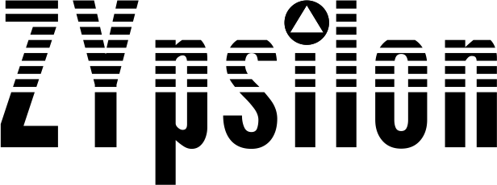

# ZYpsilon · 投影实验室

**一个免费的交互式三维画法几何实验室。** 直观呈现正投影（蒙日法）、轴测图、透视、阴影与剖切是如何作出的：投影面、立体、投射线，以及在投影面上形成的图像——全部在浏览器中运行，无需安装。1.2 版新增：**相贯实验室**，让两个立体与一个截平面相遇。

**在线使用：** [www.zypsilon.com](https://www.zypsilon.com) · **引用：** [10.5281/zenodo.24405119](https://doi.org/10.5281/zenodo.24405119) · **许可：** [PolyForm Noncommercial 1.0.0](LICENSE) · 🇬🇧 [English](README.md) · 🇮🇹 [Italiano](README.it.md)

界面提供**英语、意大利语和简体中文**（面板右上角切换）。应用始终以英语打开；用 `?lang=it` 或 `?lang=zh` 打开则以意大利语或中文开始。中文界面中，点用甲、乙、丙……表示，投影面称为正立面、水平面、侧立面。项目的权威文本为[英文版](README.md)，本页为其中文译本。

## 功能一览

- **正投影（蒙日法）**：三个投影面（正立面 V、水平面 H、侧立面 W），立体位于第一象限。*展开角度*滑块把 H 面和 W 面绕与 V 面的交线旋转，直至摊成一张图纸：主视图、俯视图和左视图，附投影轴与投影连线。顶点字母（A、A″、A′、A‴ ……）、重合投影（≡）与迹线均有标注；记号随所选语言而变。
- **正轴测图**：正等测；高级模式下还有正二测和正三测。
- **斜轴测图**：骑士投影（斜等测）、缩短骑士投影（斜二测）、单测投影（垂直面）；平面投影、缩短平面投影和军事投影（水平面）。
- **透视**：平行透视（一个灭点）、成角透视（两个）和三点透视，附视平线、基线、主点和灭点。
- **立体**：立方体、长方体和四棱锥；三角、五角、六角、八角棱柱与棱锥；圆柱、圆锥和球（绘出轮廓线）；还有**三维 ZYpsilon 标志**。多面体的顶点标有字母；曲面体则标在其定义点上。
- **尺寸**：*立体*旁的开关可输入立体尺寸（边长、长/宽/高、直径/高），取值 2 至 15，单位自定——1 可以是一厘米，也可以是一米。标志不能按尺寸设定，只能整体缩放。
- **截平面（剖切）**：真正切开立体。被切去的部分隐约可见，截断面着色，图像、虚线、蒙日投影和顶点字母都随剖切变化。在蒙日法中，截平面默认垂直于某个投影面，并与其他投影面一起展开，用经典的圆弧作图得到截断面实形；*任意平面*选项可使其朝任意方向。滑块**和键入数值**均可使用。
- **阴影**：平行光线（太阳，两个角度）或点光源（灯，三个坐标）；本影、投在基准面上的落影、光线，以及逐个顶点的引导作图。在透视中，作图使用光线的灭点（FL 与 FL′）以及过这两点的虚线**光线灭线**；只绘出真正构成阴影轮廓的顶点所引的光线，作图因而清晰易读。
- **相贯实验室**（*1.2 版新增*）：一种教学模式，由标志下方的开关开启，用于经典问题——**用截平面法求两个立体的相贯线**。在常见形体（棱柱、棱锥、圆柱、圆锥、球 ……）中选出立体 **A** 与立体 **B**，分别设定轴线（垂直或水平）、绕轴转角和位置——可用滑块**或键入数值**；*两个立体居中*可使二者回到场景中央。然后移动一个平行于水平面、正立面或侧立面的截平面（也可播放动画）：它同时截切两个立体，红点标出 A 的截断面轮廓与 B 的截断面轮廓相交之处——即**相贯线**上的点。相贯线逐点生成（可选保留节点轨迹），并在正投影和轴测图中显示，各点标有字母。*颜色*用不同色调区分两个立体与截断面。透视不属于实验室；关闭后恢复到先前的场景。
- **透视工具**：选中一条棱，可查看它在画面上的迹点、灭点、展开面作图以及测点。
- **高级模式**：方位（绕 Z、X、Y 的 ψ、φ、θ）、以立体或画面作为倾斜对象、比例、距离、光线方向（α、q）、视点，以及无法用三角板作出的其他轴测图。关闭后，只保留能用三角板绘制的投影和三种透视，与制图教材一致。
- **快捷视图与输出**：三维、俯视、侧视、“沿光线方向”；三种布局（全屏三维加小图、分屏、大图）；PNG 截图；**保存 / 打开**场景为 `.json` 文件；**链接**复制一个可重新打开同一场景的网址（设置位于 `#` 之后，浏览器从不把它发送给服务器）。

## 使用方法

打开 <https://www.zypsilon.com>，或下载本仓库后双击 `index.html`——无需服务器，离线也能运行：three.js 已包含在 `vendor/` 中。`proiezioni-standalone.html` 是同一应用的单文件版本，便于复制或发送。

操作：拖动旋转，Shift + 拖动（或右键）平移，滚轮或双指缩放。

## 几何模型

画面是垂直平面 `y = 0`，观察者位于 `y < 0`，立体在画面之后（`y > 0`）。坐标轴：X 向右，Y 向纵深，Z 向上。立体的方位由 `R = Rx(φ) · Rz(ψ)` 确定。

- 正平行投影：投射线沿 `+Y`。
- 斜平行投影：投射线沿 `(-q·cos α, 1, -q·sin α)`。
- 透视：投射线自点 `O = (Ex, -D, Ez)` 发出；方向 `a` 的灭点为 `O + a·D/a_y`（`a_y ≠ 0` 时）。

单位为纯数字：1 为起始立方体的边长。

## 许可、商业使用与引用

> 具有法律效力的文本以[英文版](README.md#licence-commercial-use-and-citation)和 [LICENSE](LICENSE) 文件为准；以下为中文概述。

**学习、教学与研究免费。** ZYpsilon 依据 [PolyForm Noncommercial License 1.0.0](LICENSE) 发布。为非商业目的的使用、复制和修改——包括学生、教师、学校、大学和公共研究机构——均免费。再分发须免费，并保持许可证、[NOTICE](NOTICE)、署名以及指向 [www.zypsilon.com](https://www.zypsilon.com) 的链接不变。

**商业使用须另行取得书面许可。** 任何以营利为目的的一方（包括出版社）或其代表的使用，都需要作者的许可：例如将本软件及其界面、图形或标志纳入或嵌入出售的或带广告的图书、数字教材、应用、课程或网站，或将其部署在商业平台上。引用或提及 ZYpsilon（例如列入参考文献）并链接到 www.zypsilon.com，对所有人免费。未经书面许可，不得使用 ZYpsilon 的名称和标志暗示认可、合作或隶属关系。

- *免费，无需询问：* 学生、教师与学校；大学与公共研究机构（非商业教学与研究）；公益组织与公共管理机构；任何引用或链接者。
- *需要许可：* 出版商（图书、数字教材、配套网站或应用）；公司与培训机构（付费课程、商业在线学习）；将 ZYpsilon 嵌入、捆绑或托管于软件或网站者；有偿活动中的职业或商业使用；其他一切商业使用。
- *联系方式：* 没有价目表，许可逐案商定。请写信至 [info@zypsilon.com](mailto:info@zypsilon.com?subject=ZYpsilon%20licence%20request)，说明您的身份、用途、面向的受众、使用期限和涉及的国家。相同信息也见应用内的“许可、使用与隐私”页面。

**如何引用。** ZYpsilon 已存档于 Zenodo：DOI [10.5281/zenodo.24405119](https://doi.org/10.5281/zenodo.24405119)，始终指向最新版本（每个发布版本还有各自的版本 DOI）。另见 [`CITATION.cff`](CITATION.cff)——GitHub 会显示“Cite this repository”按钮。以网址形式保存的场景（**链接**按钮）会打开官方网站，可自由分享；将应用嵌入其他页面或复制到其他网站，则适用许可条款。

## 隐私

应用本身不收集任何个人数据：没有账户、表单，也不向服务器发送任何内容。浏览器中只保存所选语言和同意选择。第三方服务：Google Fonts（字体），以及在线网站上的 cdnjs（three.js；若无法访问，则使用 `vendor/` 中的副本）。

**Google Analytics** 仅在官方网站（www.zypsilon.com）加载，且仅在用户同意后；首次访问时以及六个月后会显示横幅，“拒绝”与“接受”按钮同样醒目。下载的副本、本地文件和其他主机不会加载或发送任何内容，也不显示横幅。面板底部的两个链接会打开全屏页面“许可、使用与隐私”和“Cookie 与同意”（提供意大利语、英语和中文）。在您所在的司法辖区依赖这些法律文本之前，请先请专业人士审核。

## 支持项目

“支持项目”按钮指向 <https://ko-fi.com/openapp>。`.github/FUNDING.yml` 在 GitHub 上启用 *Sponsor* 按钮。

## 致谢

三维图形使用 [three.js](https://threejs.org/) r128（MIT 许可），包含在 `vendor/three.min.js` 中。IBM Plex 与 Newsreader 字体在联网时从 Google Fonts 加载；离线时使用系统字体。

由 Baires Raffaelli 以 ZYpsilon 之名开发——[www.zypsilon.com](https://www.zypsilon.com) · [info@zypsilon.com](mailto:info@zypsilon.com)。
